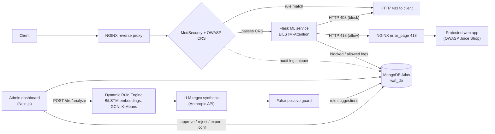

# iWAF – Intelligent Web Application Firewall

Final Year Project, NUST SEECS, 2026 (grade A)

## Overview

Rule-based web application firewalls such as ModSecurity with the OWASP Core Rule Set (CRS) block attacks that match known signatures, but payloads that use character-level obfuscation (UTF-7 encoding, HTML entity tab injection, inline SQL comments) can pass the default rule set. iWAF places a second, learned layer behind ModSecurity: every request that the CRS allows is classified by a character-level BiLSTM-Attention model, which blocks the request if it predicts an attack class with high confidence. Blocked requests are logged to MongoDB, where an offline Dynamic Rule Engine (DRE) clusters them with a multi-relational graph convolutional network and asks a large language model to propose a ModSecurity rule for each cluster. Every proposed rule is tested against benign traffic by a false-positive guard and is only marked as approved after an administrator reviews it on the dashboard. The result is a layered WAF in which the ML layer catches bypasses inline and the DRE turns them into reviewable signature rules for the first layer.

## Architecture



The system has two planes. The inline plane (NGINX, ModSecurity, Flask) handles every request. The administrative plane (dashboard, DRE, LLM) runs on demand and never sits in the request path.

### 1. NGINX reverse proxy

NGINX is the public entry point. It loads the ModSecurity connector, passes each request through the CRS, and then proxies requests that pass the CRS to the Flask ML service on `127.0.0.1:5000`. The reference configuration is in [`ml-service/nginx.conf.example`](ml-service/nginx.conf.example).

Key design choice: HTTP 418 is used as an internal allow signal between Flask and NGINX. Flask returns 418 for benign requests and 403 for blocked ones. With `proxy_intercept_errors on` and `error_page 418 = @forward_to_app`, NGINX turns a 418 into an internal redirect to the protected application, so the client receives the application's real response. A 403 is returned to the client as is. Using an otherwise unused status code means an allow decision cannot be confused with a normal 200 response from the ML service. The configuration also exposes `/ml/health` and `/ml/stats` for monitoring.

### 2. ModSecurity with the OWASP Core Rule Set

ModSecurity is the first detection layer. It blocks requests whose CRS anomaly score reaches the default threshold of 5 and writes them to its audit log. In the deployment, a separate shipper process (not part of this repository) parsed the audit log into the `attacks` collection in MongoDB so that the dashboard can show ModSecurity and ML blocks side by side. Requests that pass the CRS continue to the ML layer.

### 3. Flask ML service (BiLSTM-Attention classifier)

[`ml-service/app.py`](ml-service/app.py) receives every request that passes ModSecurity and decides in this order:

1. Internal routes (`/health`, `/stats`, `/dre/*`, `/_logger/*`) are served directly and never classified.
2. `multipart/form-data` requests skip the model. Binary file content produced false positives in a character-level text model, so file-content inspection is left to ModSecurity and application-level scanners.
3. Paths on a configurable whitelist (`WHITELISTED_PATHS` in [`config.py`](ml-service/config.py)) skip the model. The list covers static assets and the routes of the protected Juice Shop application.
4. All other requests go to the BiLSTM-Attention model. If the predicted class is an attack class and its probability is at least `CONFIDENCE_THRESHOLD` (default 0.70), the service returns 403. Otherwise it returns 418.

Every decision is written to `ml_blocked_requests` or `ml_allowed_requests` in MongoDB, with the class probabilities, and optionally to a local JSONL capture file used to collect new training data. If inference raises an exception the service fails open (returns 418) so that an ML fault cannot take the protected application offline. The model architecture is described in [Model](#model).

### 4. Dynamic Rule Engine (DRE)

The DRE runs offline when an administrator starts an analysis from the dashboard. It reads recent ML-blocked requests from MongoDB, clusters them, and produces candidate ModSecurity rules that are stored in `ml_rule_suggestions` with status `pending_review`. It connects back to the first layer: approved rules can be exported as `.conf` files and added to ModSecurity. The full pipeline is described in [Dynamic Rule Engine](#dynamic-rule-engine).

### 5. Administration dashboard

The dashboard is a separate Next.js application (see [Related repositories](#related-repositories)). It reads all four MongoDB collections, shows ModSecurity blocks, ML blocks and allowed traffic, and provides the rule review page where suggestions are approved, rejected (with a reason) or exported. It triggers DRE analysis through a server-side API route, so the browser never talks to the Flask service directly.

### 6. Data store

MongoDB Atlas (database `waf_db`) is shared by all components:

| Collection | Written by | Content |
|---|---|---|
| `attacks` | ModSecurity audit log shipper | Requests blocked or flagged by the CRS |
| `ml_blocked_requests` | Flask ML service | Requests blocked by the classifier, with probabilities |
| `ml_allowed_requests` | Flask ML service | Allowed and whitelisted requests |
| `ml_rule_suggestions` | DRE | Candidate rules, review status and deduplication metadata |

## Dataset

The classifier was trained on a unified HTTP request dataset built from five sources. Each record has the same five fields: `method`, `path`, `query_string`, `body` and `label`. The data itself is not included in this repository.

| Source | Raw rows | Notes | Link |
|---|---|---|---|
| Synthetic v2 (project-generated) | 8,769 | Bypass-focused payloads for all six classes | not public |
| CSIC-2010 HTTP dataset | 61,065 | Full HTTP requests, normal and anomalous | |
| Kaggle SQL injection dataset | 30,919 | Payload strings wrapped in a synthetic HTTP envelope | [Kaggle](https://www.kaggle.com/datasets/sajid576/sql-injection-dataset) |
| Kaggle XSS dataset | 13,686 | Payload strings wrapped in a synthetic HTTP envelope | [Kaggle](https://www.kaggle.com/datasets/syedsaqlainhussain/cross-site-scripting-xss-dataset-for-deep-learning) |
| Zenodo ModSecurity audit logs (2025, 30 days) | 142,705 | Production attack traffic parsed from ModSecurity audit logs | [Zenodo](https://zenodo.org/records/17178461) |
| **Total before cleaning** | **257,144** | | |

After cleaning, deduplication and bias correction the unified dataset has **52,321** rows in six classes:

| Class | Rows | Share |
|---|---|---|
| benign | 16,075 | 30.7% |
| sqli | 15,452 | 29.5% |
| xss | 10,009 | 19.1% |
| probe | 6,238 | 11.9% |
| cmdi | 2,325 | 4.4% |
| lfi | 2,222 | 4.2% |

The main data was split with a stratified split (seed 42) into training, validation and test sets. Two additional test sets of ModSecurity bypasses were held out and never used for training:

| Split | Rows | Share of main data |
|---|---|---|
| Train | 41,526 | 80.0% |
| Validation | 5,246 | 10.1% |
| Test | 5,116 | 9.9% |
| Adversarial test (synthetic ModSecurity bypasses) | 300 (77 sqli, 223 xss) | held out |
| Real-world test (bypasses captured against the deployment) | 133 (76 sqli, 57 xss) | held out |

Preprocessing ([`training/preprocess_unified.py`](training/preprocess_unified.py)):

- CSIC-2010 anomalous requests are mapped to the six classes by payload pattern; Kaggle payloads are wrapped in a randomly generated HTTP request (method, path, payload in query or body).
- Zenodo records that ModSecurity labelled as LFI but only request configuration files (for example `/.env`, `/.git/config`, `wp-config.php`) are relabelled as `probe`.
- Cross-source duplicates are removed by hashing method, path, query and body, and over-represented classes are downsampled.
- Two corrections were made after deployment testing: benign navigation requests (bare `GET` paths) were added because the model had learned that a bare path means `probe` ([`training/add_app_benign.py`](training/add_app_benign.py) adds 1,887 samples), and 2,450 benign JSON bodies containing e-mail addresses and punctuation were added to fix a false positive on user comments.
- At inference and training time the method, path, query and body are URL-decoded up to three times to undo nested percent-encoding, then concatenated into one string.

The real-world test set comes from red-team testing of the deployed WAF in front of OWASP Juice Shop. Requests were captured by the service's capture logger, and only requests confirmed to pass ModSecurity at its default threshold were kept.

**External bypass set.** To test generalisation to unseen payload families, a separate set of 194 attack payloads was assembled from public sources (PayloadsAllTheThings, HackTricks, public LFI lists and scanner fingerprints): 44 sqli, 42 xss, 39 lfi, 37 probe and 32 cmdi. The three bypass families used in the real-world test set were deliberately excluded. The set is rebuilt by [`training/baselines/build_bypass_set.py`](training/baselines/build_bypass_set.py).

## Model

BiLSTM-Attention with metadata fusion, defined in [`ml-service/bilstm_model.py`](ml-service/bilstm_model.py).

| Component | Setting |
|---|---|
| Tokenisation | Character level: 95 printable ASCII characters, tab/newline/carriage return, `<UNK>` and `<PAD>`; vocabulary of 101 indices |
| Sequence length | 384 characters (truncated or padded) |
| Embedding | 101 x 64 |
| Encoder | 2-layer bidirectional LSTM, hidden size 128 per direction (256 output), dropout 0.4 |
| Pooling | Additive self-attention over time steps, padding masked out |
| Metadata branch | 12 numeric features: query, body and path length; path depth; number of parameters; special-character flag; percent-encoding flag; `..` count; quote count; semicolon count; angle-bracket count; SQL keyword count |
| Classifier | Concatenate (256 + 12 = 268), Linear 268 to 128 with ReLU and dropout, Linear 128 to 6 |
| Classes | benign, cmdi, lfi, probe, sqli, xss |
| Parameters | **635,847** |

Parameter breakdown: embedding 6,464; BiLSTM layer 1 198,656; BiLSTM layer 2 395,264; attention 257; first linear layer 34,432; output layer 774.

Training ([`training/train_bilstm.py`](training/train_bilstm.py)): Adam (learning rate 1e-3, weight decay 1e-5), batch size 128, up to 25 epochs with early stopping (patience 4), cross-entropy with balanced class weights, ReduceLROnPlateau (factor 0.5) on validation accuracy, gradient clipping at norm 1.0.

The same network serves as the feature extractor for the DRE: the 256-dimensional attention output is used as the node embedding for the GCN.

## Results

### Deployed classifier

| Metric | Result |
|---|---|
| Test accuracy (5,116 held-out requests) | **98.49%** |
| Synthetic ModSecurity bypasses blocked | **100%** (300 of 300) |
| Real-world ModSecurity bypasses blocked | **100%** (133 of 133) |
| External bypass set (194 unseen public payloads) | 93.81% (182 of 194) |
| ML inference latency, p50 / p95 / p99 | 6.08 ms / 11.29 ms / **15.27 ms** |

Per-class results on the test set:

| Class | Precision | Recall | F1 | Support |
|---|---|---|---|---|
| benign | 0.99 | 1.00 | 0.99 | 1,607 |
| cmdi | 0.95 | 0.99 | 0.97 | 233 |
| lfi | 0.94 | 0.98 | 0.96 | 222 |
| probe | 0.99 | 0.97 | 0.98 | 626 |
| sqli | 1.00 | 0.97 | 0.99 | 1,492 |
| xss | 0.98 | 0.99 | 0.98 | 936 |

Latency was measured with [`ml-service/benchmark_latency.py`](ml-service/benchmark_latency.py) on CPU over 2,000 mixed benign and attack requests. The script calls the classifier in-process, so the figures cover feature extraction and model inference only; HTTP handling and the full NGINX, ModSecurity and Flask chain were not benchmarked.

### Model comparison

Seven models were trained with the same preprocessing on a separate stratified 80/10/10 re-split of the training set (33,221 / 4,152 / 4,153 rows, seed 42). Neural models used Adam (learning rate 1e-3), batch size 128, up to 25 epochs with patience 4 and class-weighted loss; DistilBERT was fine-tuned for 3 epochs with a sequence length of 256. Because the split differs, the BiLSTM-Attention accuracy here (98.65%) differs from the deployed model's 98.49%.

| Model | Test accuracy | Macro F1 | Parameters | p99 latency (ms) | External bypass set (194) |
|---|---|---|---|---|---|
| LinearSVC (char 3-5-gram TF-IDF) | 97.11% | 0.974 | 300,000 | 0.23 | 93.30% |
| CharCNN | 97.95% | 0.978 | 95,110 | 1.32 | **94.85%** |
| LSTM (unidirectional) | 79.80% | 0.792 | 371,398 | 6.20 | 69.59% |
| BiLSTM, mean pooling | 97.62% | 0.971 | 635,590 | 4.91 | 87.11% |
| BiLSTM-Attention, no metadata | 98.36% | 0.978 | 634,311 | 7.34 | 92.27% |
| **BiLSTM-Attention (deployed architecture)** | **98.65%** | **0.983** | 635,847 | 4.25 | 93.81% |
| DistilBERT (base, uncased) | 98.39% | 0.977 | 66,958,086 | 35.13 | not evaluated |

Latency in this table is single-request latency measured by the comparison scripts in their training environment and is not directly comparable with the service benchmark above. The LinearSVC parameter count is the number of weights (50,000 TF-IDF features x 6 classes). On the external bypass set the CharCNN scored slightly higher than the BiLSTM-Attention model; on the main test set the BiLSTM-Attention model had the best accuracy and macro F1. Per-model results, including confusion matrices, are in [`training/baselines/results/`](training/baselines/results/).

## Dynamic Rule Engine

Implemented in [`ml-service/dre_v2.py`](ml-service/dre_v2.py), [`gcn_model.py`](ml-service/gcn_model.py), [`llm_analyzer.py`](ml-service/llm_analyzer.py) and [`fp_guard.py`](ml-service/fp_guard.py), and exposed through [`dre_blueprint.py`](ml-service/dre_blueprint.py).

**1. Collect.** `POST /dre/analyze` reads up to 500 of the most recent requests in `ml_blocked_requests` within the selected window (1 hour, 24 hours, 7 days or 30 days). At least 4 requests are required.

**2. Embed.** Each request is passed through the trained BiLSTM up to the attention layer, giving a 256-dimensional embedding.

**3. Build a multi-relational graph.** Requests are nodes. Four adjacency matrices are built, each with self-loops and symmetric normalisation (D^-1/2 A D^-1/2):

| Edge type | Connects two requests when |
|---|---|
| Content similarity | Cosine similarity of their BiLSTM embeddings is at least 0.7 |
| Same source IP | They come from the same client IP |
| Temporal proximity | They arrive within 30 minutes of each other |
| Same path | They target the same URL path |

**4. Multi-relational GCN.** A two-layer GCN (256 to 128 to 64, L2-normalised output, 205,768 parameters) gives each relation its own weight matrix plus a self-loop transform, and combines relations with learnable importance weights that are passed through a softmax. It was trained with an InfoNCE-style contrastive loss (temperature 0.3) on 800 requests per class for 30 epochs, using class labels as positive pairs ([`train_gcn.py`](ml-service/train_gcn.py)). The learned relation weights in the deployed model are:

| Relation | Weight |
|---|---|
| Same source IP | 0.315 |
| Temporal proximity | 0.239 |
| Content similarity | 0.223 |
| Same path | 0.223 |

K-Means with six clusters on the GCN embeddings gave a silhouette score of 0.987 (0.499 before training) and a homogeneity of 1.000. Because the training IPs and timestamps for most sources were synthetic, the GCN was also retrained on real IPs and timestamps from the Zenodo audit logs ([`train_gcn_real.py`](ml-service/train_gcn_real.py)). With real IPs and class-supervised loss, same source IP remained the highest-weighted relation (0.292) and clustering reached a silhouette of 0.842 and homogeneity of 0.923. Full results are in [`results_gcn_real/summary.json`](ml-service/results_gcn_real/summary.json).

**5. Cluster.** K-Means is run on the GCN embeddings with k between 2 and min(10, n/2), selected by silhouette score.

**6. LLM regex synthesis.** For every cluster with at least two requests, a summary (size, attack-type mix, HTTP methods, number of source IPs and up to eight sample requests) is sent to an LLM with a structured prompt. The LLM returns JSON with the technique name, a description, a PCRE regex, a false-positive risk estimate, a severity and the ModSecurity targets. The provider is chosen automatically: Anthropic (`claude-haiku-4-5` by default), then a local Ollama model, then a heuristic fallback that recognises three known bypass families (UTF-7 encoding, HTML entity tab injection and inline-comment SQL injection). The response is turned into a `SecRule` with action `deny,log`, or `log,pass` when there is no pattern or the LLM rates the false-positive risk as high.

**7. False-positive guard.** The regex is run against 500 benign training requests. A match rate of 0 is SAFE, up to 0.5% is ACCEPTABLE, up to 2.5% is RISKY (confidence lowered by one level) and above that is DANGEROUS (confidence set to LOW and the rule switched to `log,pass`). Invalid or empty patterns are set to LOW confidence. The initial confidence comes from the cluster size and the LLM's risk estimate.

**8. Deduplicate and store.** Suggestions are keyed on attack type and technique name. A repeat of a pending or approved suggestion increments its `seen_count`; a technique that was previously rejected is suggested again together with the earlier rejection reason. The collection keeps the 200 most recent suggestions.

**9. Human approval.** Nothing is deployed automatically. An administrator reviews each suggestion on the dashboard and approves it (with optional notes), rejects it (with a reason) or exports it as a `.conf` file for ModSecurity.

**Measured rule quality** ([`quantify_llm_synthesis.py`](ml-service/quantify_llm_synthesis.py), 10 runs of 100 blocked requests sampled from the Zenodo data, 88 clusters): with the Anthropic provider all 88 clusters produced a valid regex and a well-formed rule, and on a held-out set of 500 benign requests 86 rules were SAFE and 2 ACCEPTABLE. The heuristic fallback produced no usable regex for the same clusters. Results are in [`results_llm/summary.json`](ml-service/results_llm/summary.json).

## Repository structure

```
.
├── README.md                          Project documentation
├── LICENSE                            MIT license
├── .env.example                       Environment variable template (placeholders only)
├── .gitignore                         Excludes secrets, data, weights and logs
├── ml-service/
│   ├── app.py                         Flask service: whitelist, multipart bypass, inference, 403/418 decision, MongoDB logging
│   ├── config.py                      Configuration loaded from environment variables and .env
│   ├── model.py                       Inference wrapper that loads the artifacts and returns class probabilities
│   ├── bilstm_model.py                Character tokenizer, metadata features and the BiLSTM-Attention network
│   ├── feature_extractor.py           Extracts method, path, query, body and headers from a Flask request
│   ├── request_logger.py              Thread-safe JSONL capture logger for collecting new training data
│   ├── embedding_extractor.py         Extracts 256-dimensional BiLSTM embeddings for the DRE
│   ├── gcn_model.py                   Multi-relational GCN, graph builder and contrastive loss
│   ├── dre_v2.py                      DRE pipeline: fetch, embed, graph, cluster, LLM, FP guard, deduplicated storage
│   ├── dre_blueprint.py               DRE REST endpoints: analyze, list, approve, reject, export, stats, info
│   ├── llm_analyzer.py                Anthropic, Ollama and heuristic providers and the SecRule builder
│   ├── fp_guard.py                    False-positive guard that tests regexes against benign traffic
│   ├── train_gcn.py                   Contrastive training of the GCN on BiLSTM embeddings
│   ├── train_gcn_real.py              GCN retraining on real IPs and timestamps (three conditions)
│   ├── quantify_llm_synthesis.py      Evaluation of LLM rule synthesis against the heuristic baseline
│   ├── benchmark_latency.py           Inference latency benchmark
│   ├── nginx.conf.example             NGINX and ModSecurity reference configuration
│   ├── Dockerfile                     Container image for the ML service
│   ├── .dockerignore                  Files excluded from the Docker build context
│   ├── requirements.txt               Service dependencies
│   ├── artifacts/
│   │   ├── README.md                  Which model files are expected and which are published
│   │   ├── model_info.json            BiLSTM configuration and metrics
│   │   └── gcn_info.json              GCN configuration, relation weights and clustering metrics
│   ├── results_gcn_real/summary.json  GCN retraining results on real IPs and timestamps
│   └── results_llm/summary.json       LLM rule synthesis evaluation summary
└── training/
    ├── preprocess_unified.py          Builds the unified dataset and the stratified splits from the raw sources
    ├── add_app_benign.py              Adds benign navigation samples (bare-path bias correction)
    ├── parse_modsec_audit.py          Parses ModSecurity audit logs into CSV with labels, IPs and timestamps
    ├── train_bilstm.py                Trains and evaluates the BiLSTM-Attention classifier
    ├── requirements.txt               Training dependencies
    └── baselines/
        ├── make_splits.py             Stratified 80/10/10 re-split used for the model comparison
        ├── data_utils.py              Shared tokenizer, features and data loading for all baselines
        ├── models.py                  CharCNN, LSTM, BiLSTM variants and BiLSTM-Attention
        ├── evaluate_common.py         Shared metrics, confusion matrix and latency measurement
        ├── train_linearsvc.py         LinearSVC with character TF-IDF baseline
        ├── train_neural.py            Trains the neural baselines and ablations
        ├── train_distilbert.py        DistilBERT baseline
        ├── run_all.sh                 Runs all seven models in sequence
        ├── build_bypass_set.py        Builds the 194-payload external bypass set
        ├── eval_external_bypass.py    Evaluates one checkpoint on the external bypass set
        ├── eval_bypass_all.py         Evaluates all models on the external bypass set
        └── results/                   Per-model metrics (JSON)
```

## Getting started

### Configuration

Copy the template and fill in your own values. The service loads `.env` with python-dotenv, searching upwards from `ml-service/`, so a `.env` file in the repository root is found automatically.

```bash
cp .env.example .env
```

| Variable | Required | Purpose |
|---|---|---|
| `MONGODB_URI` | Yes, for logging and the DRE | MongoDB connection string. Without it the service still classifies but does not log. |
| `MONGO_DB` | No | Database name (default `waf_db`) |
| `ANTHROPIC_API_KEY` | No | Enables LLM rule synthesis; otherwise the DRE uses Ollama or the heuristic fallback |
| `LLM_MODEL` | No | Anthropic model name (default `claude-haiku-4-5-20251001`) |
| `LLM_PREFERENCE` | No | `auto`, `anthropic`, `ollama` or `heuristic` |
| `CONFIDENCE_THRESHOLD` | No | Minimum attack probability needed to block (default 0.70) |
| `SERVICE_HOST`, `SERVICE_PORT` | No | Bind address for `python app.py` (default `0.0.0.0:5000`) |
| `LOG_LEVEL` | No | Python logging level (default `INFO`) |

### Model weights

The trained weights are not included in this repository and are available on request. Place `bilstm.pt`, `tokenizer.pkl`, `label_encoder.pkl` and, for the DRE, `gcn.pt` in `ml-service/artifacts/` (see [`artifacts/README.md`](ml-service/artifacts/README.md)), or train them with `training/train_bilstm.py` and `ml-service/train_gcn.py`.

### Run with Docker

```bash
cd ml-service
docker build -t iwaf-ml .
docker run -p 5000:5000 --env-file ../.env iwaf-ml
```

### Run locally

```bash
cd ml-service
pip install -r requirements.txt
python app.py
```

### Check the service

```bash
# Benign request: HTTP 418 (internal allow signal)
curl -i "http://localhost:5000/search?q=python+tutorial"

# SQL injection: HTTP 403 (blocked by the ML layer)
curl -i "http://localhost:5000/search?q=' OR 1=1--"

# Component status of the Dynamic Rule Engine
curl http://localhost:5000/dre/info
```

To put the service behind NGINX and ModSecurity, follow the steps at the end of [`ml-service/nginx.conf.example`](ml-service/nginx.conf.example).

### Reproduce training

```bash
cd training
pip install -r requirements.txt
python preprocess_unified.py --raw-dir data/raw --out-dir data/unified
# copy the splits to training/unified_v2/, then:
python train_bilstm.py
```

The synthetic v2 source file is not public, so a full rebuild of the dataset needs the other four sources and the script's `--synthetic` option pointed at an equivalent file.

## Related repositories

- [iwaf-dashboard](https://github.com/rehan-hdr/iwaf-dashboard): the administration dashboard (Next.js and MongoDB), built by Rehan Haider with contributions from Ali Abdullah.

## Team

Ali Abdullah, Rehan Haider, Syed Fahad Shah

Supervisor: Mehdi Hussain (Advisor), Dr. Sana Qadir (Co-Advisor)

National University of Sciences and Technology (NUST), School of Electrical Engineering and Computer Science (SEECS)
